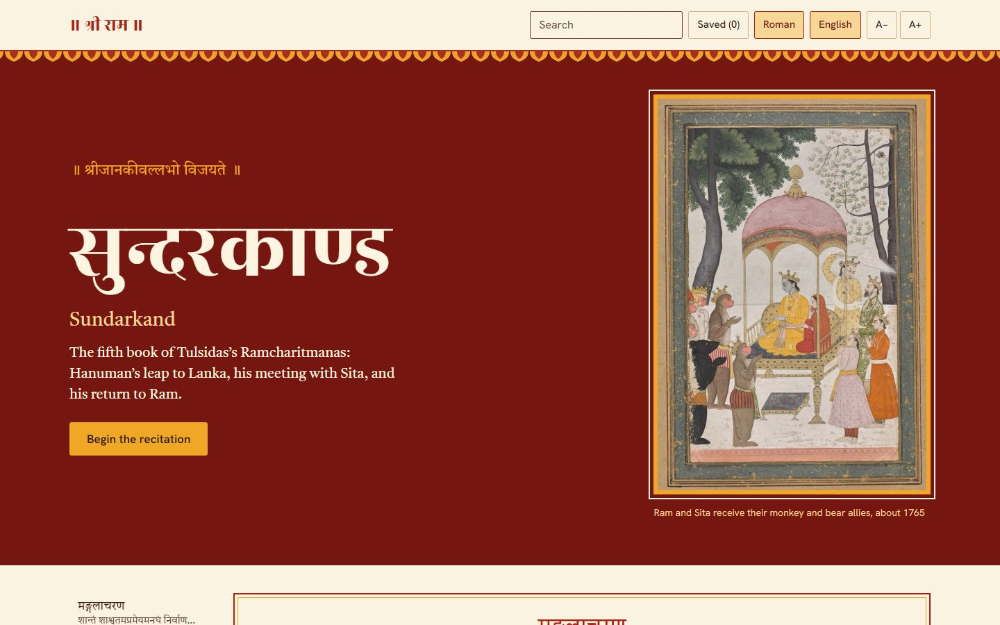
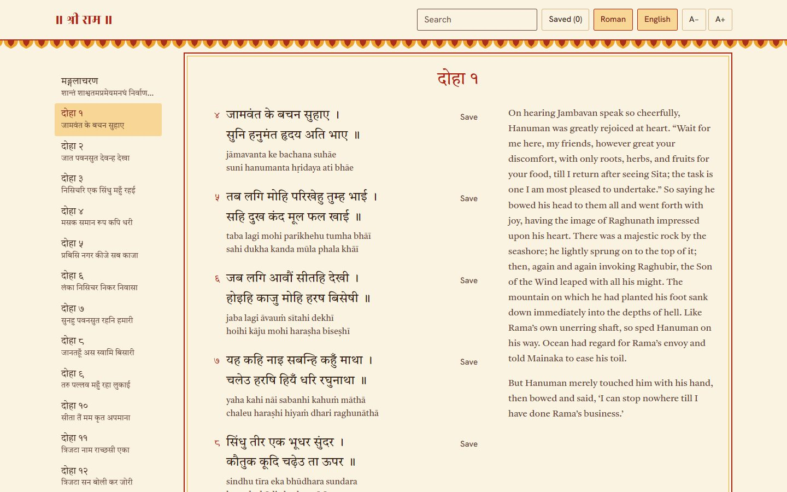

# Sundarkand

A reader for the Sundarkand, the fifth book of Tulsidas's Ramcharitmanas. It holds all 60 dohas in Devanagari and roman letters, with F. S. Growse's English translation beside each passage.

**[Read it online](https://kalpkj.github.io/sundarkand/)**





## Features

- Contents by doha, with the current passage marked as you scroll
- Search in Devanagari, English, or roman letters typed without accents
- Roman and English text that can be hidden for recitation
- Saved verses, text size and last reading position kept in the browser
- A link for every passage and verse, such as `/#doha-8` or `/#verse-100`

## Run it

Requires Node 22.12 or later.

```bash
npm install
npm run dev
```

| Command | Purpose |
| --- | --- |
| `npm run build` | Production build in `dist` |
| `npm run lint` | ESLint |
| `npm test` | Vitest tests for the text, grouping and search |

## Code layout

| Path | Contents |
| --- | --- |
| `src/data` | The text, with [its sources and checks](src/data/README.md) |
| `src/lib/text.js` | Numbering, labels and search, as pure functions |
| `src/hooks` | Stored state, URL filter and scroll tracking |
| `src/components` | Opening, passages, verses, toolbar and closing |
| `src/assets` | Three paintings from the Cleveland Museum of Art (CC0) |

Built with React and Vite. There is no backend.

## Licences

The code is under the [MIT License](LICENSE). The text database in `src/data` is under the [Open Database License](src/data/LICENSE-ODbL.txt), and Growse's translation within it is in the public domain. The paintings are CC0.
